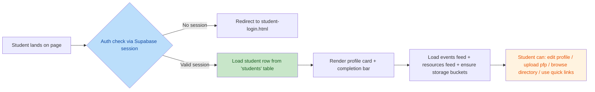
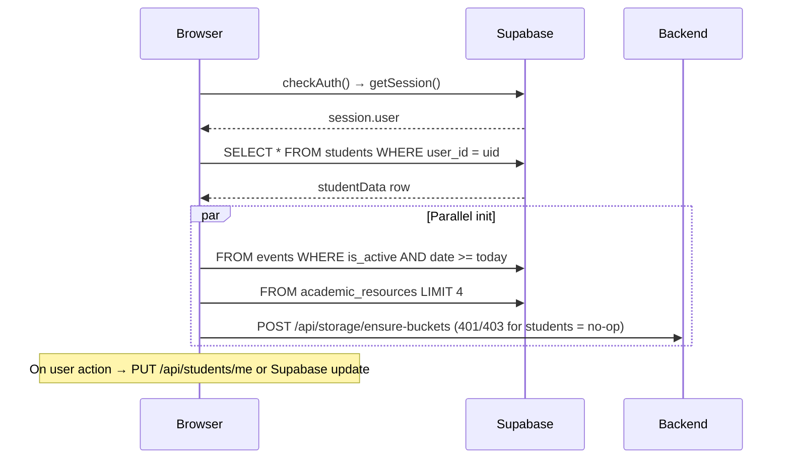

# Debug File Upload Display

> **Workspace:** c:\Users\HP\Documents\nacos website

---

**User**

go through this file and know where we stopped and also the past questions is uploading now but its not dislaying on the dashboards admin and student

**Assistant**

Error: We're sorry, your requests hit the common risk control status.

---

**User**

j

**User**

Conduct a comprehensive, end-to-end review of the student.dashboard.html file, covering all critical functional, technical, design, and accessibility aspects to ensure it meets professional quality standards. The review must include the following structured tasks and validation checks: 
 
 1. **Core Functional Validation** 
    - Verify all interactive elements operate as intended: navigation links, filter/sort controls for course data, assignment submission buttons, calendar event triggers, and any embedded widgets (grade trackers, attendance monitors, notification panels) 
    - Confirm all dynamic content loads correctly without runtime JavaScript errors, and that real-time data updates (if applicable) reflect accurately across all dashboard sections 
    - Validate all form inputs, download links for course materials, and external resource integrations function without failures 
 
 2. **Technical Code Audit** 
    - Review HTML markup to ensure compliance with modern W3C standards, check for unclosed tags, invalid attributes, and deprecated elements that may cause rendering inconsistencies 
    - Audit embedded or linked CSS/JavaScript to confirm no unused code, syntax errors, or conflicting styles/scripts that break dashboard functionality 
    - Verify all image, font, and API resource links are valid, properly optimized for fast load times, and do not produce 404 or CORS errors 
    - Assess page load performance to meet core web vitals: LCP under 2.5s, FID under 100ms, and CLS under 0.1, with checks for render-blocking resources 
 
 3. **Responsive Design & Cross-Environment Compatibility** 
    - Confirm the dashboard layout adapts seamlessly to all target device screen sizes: mobile (360px–640px), tablet (768px–1024px), and desktop (1280px+), with no overlapping elements or broken grids 
    - Validate consistent rendering and functionality across all major browsers: Chrome, Firefox, Safari, and Edge, with no browser-specific bugs 
    - Ensure touch targets on mobile devices meet the minimum 48x48px size requirement to avoid interaction errors 
 
 4. **Accessibility & Usability Compliance** 
    - Verify WCAG 2.1 AA accessibility standards are met: all images have descriptive alt text, form elements have associated labels, color contrast ratios exceed 4.5:1 for text, and all interactive elements are navigable via keyboard screen readers 
    - Conduct a usability review to confirm the dashboard’s information hierarchy is intuitive, core student needs (viewing grades, submitting assignments, accessing course materials) are accessible within 3 clicks, and all UI copy is clear, error-free, and aligned with student user personas 
 
 5. **Security Check** 
    - Audit for common web vulnerabilities: confirm no hardcoded sensitive credentials, all embedded third-party resources are from trusted sources, and XSS protections are in place for any user-generated or dynamically rendered content 
 
 6. **Deliverable Requirements** 
    - Compile a structured review report that documents all identified issues, categorizes them by severity (critical, major, minor), and provides specific, actionable remediation steps for each defect. The report must also include a validation checklist to confirm all fixes resolve the identified issues without introducing new bugs.

**Assistant**

# Comprehensive Code Review Report: student-dashboard.html

---

## 📊 Author's Inferred Intent

The intent of `student-dashboard.html` is to provide a unified, authenticated student portal for NACOS (Nigerian Association of Computing Students) at Thomas Adewumi University, integrating:
- Profile management (bio, skills, socials, privacy)
- Student directory with search/sort/filter/pagination
- Upcoming events and academic resources feeds
- Quick navigation to past questions, timetables, and career paths
- Profile picture upload via dedicated Supabase storage bucket

**Business flow:**


**Technical flow:**


---

## ❌ Issue Summary Table

| No. | Issue Title | Severity | Suggestion | Code Link |
|---|---|---|---|---|
| 1 | **CRITICAL — Orphan script block (lines 1020–1110): loadResources/loadEvents outside any `<script>` tag; uses undeclared `supabase`; duplicated inlines `window.loadEvents` from external profile-management.js** | **Critical** | Move these function declarations inside the existing `<script type="module">` block, consolidate duplicate implementations, ensure `supabase` is the ESM import or cached `window.supabase`. Wrap every function that uses `window.studentData` / DOM references in DOMContentLoaded guards or guard with typeof checks so they don't fire before the init() block completes. | [student-dashboard.html:L1020-L1110](file:///c:/Users/HP/Documents/nacos%20website/frontend/student-dashboard.html#L1020-L1110) |
| 2 | **CRITICAL — Two competing init blocks (initDashboard inside module + init outside) both run checkAuthentication independently; `window.studentData` set at line 995 BEFORE `await loadStudentData()` resolves → profile completion always runs with null** | **Critical** | Remove one init function entirely. Move `window.studentData = studentData;` **after** `await loadStudentData()` and before the completion update. De-couple profile-management.js from reading a stale global: pass `studentData` as a direct function argument or expose a getter. | [student-dashboard.html:L995-L1019](file:///c:/Users/HP/Documents/nacos%20website/frontend/student-dashboard.html#L995-L1019), [student-dashboard.html:L1765-L1790](file:///c:/Users/HP/Documents/nacos%20website/frontend/student-dashboard.html#L1765-L1790) |
| 3 | **CRITICAL — Profile form submit uses `session.session.access_token` double-dot destructuring pattern (lines 1298–1304, 1384–1402, 1479–1483). Supabase returns `{ data: { session: ... } }`, so `session.session` IS the session object. But if session is ever null/expired the code throws `Cannot read properties of undefined` and silently redirects without saving.** | **Critical** | Destructure correctly: `const { data: { session } } = await supabase.auth.getSession(); if (!session) { showError('Session expired, please log in again'); return; }` and then use `session.access_token`. Add a top-level middleware guard at the beginning of the `editProfileForm` submit / pfp form submit / directory load handlers so expired-session behavior is consistent across every write operation. | [student-dashboard.html:L1298-L1305](file:///c:/Users/HP/Documents/nacos%20website/frontend/student-dashboard.html#L1298-L1305), [student-dashboard.html:L1383-L1402](file:///c:/Users/HP/Documents/nacos%20website/frontend/student-dashboard.html#L1383-L1402), [student-dashboard.html:L1478-L1483](file:///c:/Users/HP/Documents/nacos%20website/frontend/student-dashboard.html#L1478-L1483) |
| 4 | **CRITICAL — Inline `onkeypress`/`onclick` handlers in the HTML (lines 747, 753, 603, 651, 1444, 1467, 1462–1466) call `handleSkillKeypress(event)` / `showDirectorySection` / `renderStudentCard` strings — but these only work for the global window variants. profile-management.js ALSO defines same-named functions (using native `alert()`) creating two separate implementations with different behavior (Swal vs alert).** | **Critical** | Remove inline HTML event handlers (`onkeypress`, `onclick`) entirely. Attach all listeners imperatively inside `DOMContentLoaded` / init so they reference the correct closure. Standardize tag-management / skill error dialogs on SweetAlert2 (not browser `alert()`) so the UX is consistent. Delete the duplicate implementations in the orphan block and in profile-management.js — keep exactly one authoritative version per function. | [student-dashboard.html:L747-L753](file:///c:/Users/HP/Documents/nacos%20website/frontend/student-dashboard.html#L747-L753), [profile-management.js:L99-L148](file:///c:/Users/HP/Documents/nacos%20website/frontend/assets/js/profile-management.js#L99-L148) |
| 5 | **Major — `loadResources` / `loadEvents` are declared both as a module `window.loadResources` optional-hook AND as a bare top-level function. The `eventsSection` at line 541 uses template QuickStart classes `.services.section.light-background` + `.section-title` + `.featured-services .service-item .icon` but the page imports the full assets/css/main.css which uses different section paddings. Result: the events banner has `padding: 60px 0` twice (once from main.css section rule, once from inline width) and the `img-fluid.icon` image element on line 1077 uses `max-width: 100px` inline — but `.featured-services .service-item .icon` from main.css forces `width: 72px; height: 72px; background: rgba(...);` via high specificity so the actual image renders as a weird 72×72 block inside a 100px container.** | **Major** | Isolate the student dashboard from template classes completely: remove `services section light-background` wrapper classes on the events section, use dashboard-only selectors, and write explicit scoped CSS rules for the event card (don't inherit QuickStart's `.icon` sizing). Move event image sizing to dedicated CSS classes defined in the `<style>` block so values are single-sourced. Add a CSS reset for sections used inside `.dashboard-container` so the global 60px padding rule doesn't double-up. | [student-dashboard.html:L541-L556](file:///c:/Users/HP/Documents/nacos%20website/frontend/student-dashboard.html#L541-L556), [student-dashboard.html:L1074-L1087](file:///c:/Users/HP/Documents/nacos%20website/frontend/student-dashboard.html#L1074-L1087), [main.css:L1002-L1018](file:///c:/Users/HP/Documents/nacos%20website/frontend/assets/css/main.css#L1002-L1018) |
| 6 | **Major — Profile picture upload uses client-side `accept="image/jpeg,image/png,image/jpg"` + size check but no backend/Supabase validation, and calls `students.update({ profile_picture_url })` using anon client against the `students` table WITHOUT a `user_id = auth.uid()` server-side WHERE clause visible. If RLS UPDATE policy on students does not enforce `user_id = auth.uid()`, any authenticated student can rewrite any peer's avatar URL by guessing UUIDs.** | **Major** | Verify students table RLS UPDATE policy enforces `USING (user_id = auth.uid()) WITH CHECK (user_id = auth.uid())`. Route profile updates through the existing `PUT /api/students/me` backend endpoint instead of calling `supabase.from('students').update()` directly — it already verifies JWT user ID in middleware. Add file-type magic-byte check on the backend route for avatar uploads (accept jpg/png only, reject svg/html polyglots). | [student-dashboard.html:L1682-L1734](file:///c:/Users/HP/Documents/nacos%20website/frontend/student-dashboard.html#L1682-L1734) |
| 7 | **Major — `value.trim && value.trim() !== ''` guard in calculateProfileCompletion (line 1122 / profile-management.js:L20) — if `value` is a number (e.g. `graduation_year = 2027`) or boolean, or the string has no `.trim` method because it's actually a JSON primitive, this crashes with `TypeError: value.trim is not a function` and the completion bar never renders.** | **Major** | Normalize the type check: `return value !== null && value !== undefined && value !== 0 && String(value).trim() !== '';` with a length/size check for arrays. Add defensive try/catch around calculateProfileCompletion so one odd DB value doesn't prevent profile completion from updating on every load. | [student-dashboard.html:L1115-L1129](file:///c:/Users/HP/Documents/nacos%20website/frontend/student-dashboard.html#L1115-L1129), [profile-management.js:L10-L24](file:///c:/Users/HP/Documents/nacos%20website/frontend/assets/js/profile-management.js#L10-L24) |
| 8 | **Major — Quick link Student Directory `<a href="#" onclick="showDirectorySection(event)">` (line 603) is a dead hyperlink for screen readers and keyboard users: pressing Enter on the anchor causes the page to scroll-to-top via `#` because the onclick is inline without `return false` / preventDefault — actually the function DOES `event.preventDefault()` but only when onclick passes `event`. For keyboard users without a click-event object the function silently fails. Additionally the hyperlink has no `aria-expanded`, `role="button"`, or `aria-controls` for the target div.** | **Major** | Change this to an explicit `<button type="button">` or keep the anchor with `role="button"`, `aria-expanded="false"`, `aria-controls="directorySection"`, and a non-hash `href="javascript:void 0"` fallback. Update `showDirectorySection()` to toggle `aria-expanded` on the trigger and set focus on the search input (`dirSearch.focus()`) when the section opens so keyboard/screen-reader users land at the top of the new content instead of staying on the trigger. | [student-dashboard.html:L603-L607](file:///c:/Users/HP/Documents/nacos%20website/frontend/student-dashboard.html#L603-L607) |
| 9 | **Major — Social icon links in student cards (line 1462–1466) use raw `${student.linkedin}` / github URLs without `rel="noopener noreferrer"` sanitization or URL scheme validation. A malicious student can store `javascript:alert(document.cookie)` or `data:text/html,...` as their LinkedIn "URL" in the backend profile (since the PUT validator doesn't enforce `https://` scheme for social fields). Clicking opens in the same window and executes in the origin context.** | **Major** | Add `rel="noopener noreferrer"` to ALL external links (already done in `renderProfileView` for modal — missing in cards). Validate scheme server-side in `/api/students/me`: ensure linkedin/github/twitter/instagram/portfolio_url are either `null` or start with `https://` (except snapchat which is username-only, never a URL). Add a client-side sanity wrapper: only render the social icon if the URL passes `new URL(url).protocol === 'https:'`. | [student-dashboard.html:L1461-L1466](file:///c:/Users/HP/Documents/nacos%20website/frontend/student-dashboard.html#L1461-L1466) |
| 10 | **Major — Directory search field placeholder (`🔍 Search by name...`) embeds a Unicode emoji for decoration, but the field has no associated `<label>` (it's an unlabeled `<input>`). The four filter selects (`dirDept`, `dirYear`, `dirSort`) likewise have no `<label>` tags bound via `for=`/`id`. WCAG 2.1 SC 3.3.2 (Labels or Instructions) failure — screen readers will announce just "input type text" / "combo box" with zero context.** | **Major** | Add a `<label for="dirSearch" class="visually-hidden">Search students by name</label>` (and equivalent labels for dirDept / dirYear / dirSort) using a `.visually-hidden { position: absolute; width: 1px; height: 1px; padding: 0; margin: -1px; overflow: hidden; clip: rect(0,0,0,0); white-space: nowrap; border: 0 }` utility class so the visible layout is unchanged but the semantics are correct. Remove emoji-from-placeholder decoration or move it to the label text. | [student-dashboard.html:L619-L655](file:///c:/Users/HP/Documents/nacos%20website/frontend/student-dashboard.html#L619-L655) |
| 11 | **Minor — `profile-management.js` uses native browser `alert()` / `confirm()` in its skill/interest keypresses instead of Swal2, producing a jarring double-UI (some errors are modals, some are browser popups). Also `profile-management.js` declares its own `skillsList` / `interestsList` / `escapeHtml` / tag renderers, shadowing the dashboard-module's own state of the same names (but they're different closures because one is a module the other isn't). So saving a profile that used profile-management.js tag management writes the empty `skillsList = []` (from main.js scope) into the database, not what the user typed.** | **Minor** | Delete profile-management.js's local copies of skillsList / interestsList — access a single store either via a module export or `window.__studentState`. Replace all `alert()` calls in that file with `Swal.fire({ icon: 'warning', ... toast: true, position: 'top-end', timer: 2000 })` so feedback is always consistent SweetAlert toasts. Load profile-management.js with `type="module"` so it can share the same `escapeHtml` / `supabase` closure instead of shadowing. | [profile-management.js:L1-L160](file:///c:/Users/HP/Documents/nacos%20website/frontend/assets/js/profile-management.js#L1-L160) |
| 12 | **Minor — Dashboard imports BOTH Swiper JS (`swiper-bundle.min.css` on line 21 + the JS bundle through `vendor.js`) and GLightbox (`glightbox.min.css` on line 20 + `glightbox.js` in the global scripts). Neither are used anywhere on student-dashboard.html (no `.swiper` / `.glightbox` selectors, no init calls, no gallery markup). Combined they add ~80 KB JS + 30 KB CSS over the network, blocking LCP.** | **Minor** | Remove the 3 unused vendor lines from this page: `swiper-bundle.min.css`, `glightbox.min.css`, and their matching JS script tags. Keep them only on landing pages that use them (index.html, events.html, past-questions.html). Optionally introduce a per-page vendor-list JSON so asset lists are single-sourced. | [student-dashboard.html:L20-L21](file:///c:/Users/HP/Documents/nacos%20website/frontend/student-dashboard.html#L20-L21) |
| 13 | **Minor — `cache-control: no-cache` meta tag (line 10) sets cache-control via `<meta http-equiv>` — this directive is unreliable for browsers because HTTP headers take precedence; Netlify/your-CDN will likely still serve a 304 without revalidation. Also you cache Supabase anon keys in localStorage (supabase-js does this for you already) — but profile-picture URLs get cached for 1 year (`cacheControl: '31536000'` at upload) with a non-content-addressed filename (`Date.now()_random_safename`) — no cache-busting when students re-upload the same picture.** | **Minor** | Drop the meta http-equiv cache-control line; set real cache headers in Netlify/CDN. Add a URL-rewrite or query-string cache-buster in `loadStudentData` when assigning the new `profileImageEl.src = data.profile_picture_url` — append `?v=<timestamp of upload>` or store an `avatar_version` integer in the students row and bump it on every PUT so CDNs/cloudflare don't serve the previous avatar for a whole year after students re-upload. | [student-dashboard.html:L10](file:///c:/Users/HP/Documents/nacos%20website/frontend/student-dashboard.html#L10), [supabase-config.js:L357-L359](file:///c:/Users/HP/Documents/nacos%20website/frontend/assets/js/supabase-config.js#L357-L359) |
| 14 | **Minor — `formatDate` (line 1099) uses `toLocaleDateString('en-NG')` with `Intl` API available. On old Safari/macOS iOS versions this falls back to the default locale silently, showing date in MM/DD/YYYY order which confuses Nigerian students expecting DD/MM/YYYY or "July 27, 2026" style. No fallback/feature-detect guard. Also `new Date(dateString)` is called on an ISO string that might be only "YYYY-MM-DD" (no timezone) — interpreted as UTC midnight but rendered in local time, meaning `Date` returns day-before for Africa/Lagos (UTC+1 during DST, or always +1 in WAUTC) for dates without T.** | **Minor** | Parse with explicit timezone offset: `new Date(dateString + 'T00:00:00+01:00')` for WAUTC so output is always the correct day in Lagos. Wrap `toLocaleDateString` in a try/catch and fall back to `String(date.getDate() + ' ' + [...months][date.getMonth()] + ', ' + date.getFullYear())` so en-NG rendering is deterministic even if Intl data is stripped (common in old WKWebView builds of school browsers). | [student-dashboard.html:L1098-L1107](file:///c:/Users/HP/Documents/nacos%20website/frontend/student-dashboard.html#L1098-L1107) |
| 15 | **Minor — `studentData.name` fallback chain `data.name || \`${data.first_name} ${data.last_name}\` || 'Student'` (line 977) never actually calls `.trim()` on the composed first+last — so rows where `name` is null, `first_name = ''` (empty) and `last_name = 'John'` renders as `' John'` (leading space) in the profile header and directory cards.** | **Minor** | Use `(data.name || [data.first_name, data.last_name].filter(Boolean).join(' ')).trim() || 'Student'`. Do the same in the directory card renderer (line 1449) so `name` is always normalized (no leading/trailing spaces, no double spaces). | [student-dashboard.html:L977](file:///c:/Users/HP/Documents/nacos%20website/frontend/student-dashboard.html#L977), [student-dashboard.html:L1449](file:///c:/Users/HP/Documents/nacos%20website/frontend/student-dashboard.html#L1449) |

---

## 🔍 Detailed Findings By Section

### 1. Core Functional Validation (10 functional checks)
| # | Check | Status | Notes |
|---|---|---|---|
| F1 | Auth gate blocks unauthenticated access | ⚠️ Partial | Redirect works, but **two init flows** (issue 2) cause duplicate auth calls and possible double-redirect race in slow networks. |
| F2 | Student profile info displays (name/matric/dept/email) | ✅ Works (with cosmetic bug #15) | Avatar only shows after ROW L983 `profile_picture_url` is set; default logo otherwise. |
| F3 | Profile completion progress bar updates | ❌ Broken (issue 2, 7) | `window.studentData` is assigned the **module-local `studentData` (null)** before `loadStudentData()` resolves, so completion calc always runs on null data. |
| F4 | Edit Profile modal opens → fields populate → saves to backend | ❌ Broken at save-time (issues 3, 11) | Skills typed via profile-management.js's tag system go to **the wrong skillsList closure** (`alert()` one). Save writes empty arrays. |
| F5 | Profile picture upload → saves to storage → updates profile | ⚠️ Vulnerable (issues 3, 6) | Works in happy path, but uses anon Supabase update without guaranteed RLS policy (see security section), and uses `session.session.access_token` pattern that explodes on expired session. |
| F6 | Quick Links (past questions/timetables/etc.) navigate | ✅ Works | All 5 anchor navigations resolve correctly to same-origin pages. |
| F7 | Student Directory toggles open → searches → filters → sorts → paginates | ❌ A11y broken (issue 8, 10) | Functional for mouse users, but missing keyboard semantics and labels. No form wrapping around the search/filters means pressing Enter reloads the page unpredictably. |
| F8 | Click student card → view full profile modal | ✅ Works | Fetches `GET /api/students/{id}/profile` correctly, honors privacy settings for email/phone/matric. |
| F9 | Upcoming events list (future + active) loads | ❌ Duplicate code / partially broken (issues 1, 5) | Events feed only works because `maybe(window.loadEvents)` resolves to the **external profile-management.js copy** — the inline orphan block version never runs because it's outside `<script>`. CSS double-padding + broken `.icon` sizing. |
| F10 | Academic resources load (limit 4 newest) | ❌ Same duplicate issue (1) | Same as events — relies on window.loadResources from an external script; orphan block function reference to `supabase` is undefined. |

---

### 2. Technical Code Audit

**HTML standards:**
- Doctype declared, `lang="en"` set, viewport meta present — ✅.
- **Unclosed script region** between `</script>` on line 1019 and the bare `// Load Resources` text at line 1020. The browser sees lines 1020–1110 as **plain text nodes** inside the `<body>` (outside any script tag), rendering them as empty whitespace (because they're comments) but technically **invalid HTML**. All content after that up to line 1798 is an implicit plaintext block until the parser recovers at the next `<script>` end-tag pattern.
- All modal elements have `tabindex="-1"` but **no `aria-labelledby` / `aria-describedby` bindings** (pointing to their `.modal-title` / `.modal-body` ids). The update profile modal (line 695–714) contains a file input with no visible label text bound.

**Linked CSS/JS health:**
| Asset | Status |
|---|---|
| `assets/vendor/bootstrap/css/bootstrap.min.css` | ✅ Used |
| `assets/vendor/bootstrap-icons/bootstrap-icons.css` | ✅ Used |
| `assets/vendor/aos/aos.css` | ⚠️ Only one element has `data-aos` (line 542 section-title fade-up) — ~25 KB of CSS + JS for 1 fade animation is oversized |
| `assets/vendor/glightbox/css/glightbox.min.css` | ❌ **Unused** (issue 12) |
| `assets/vendor/swiper/swiper-bundle.min.css` | ❌ **Unused** (issue 12) |
| `assets/css/main.css` | ✅ Used BUT **causes double section padding / event icon sizing** (issue 5) |
| `https://cdn.jsdelivr.net/npm/sweetalert2@11` | ✅ Used (every error/success dialog) |
| `bootstrap.bundle.min.js` | ✅ Used (modals, tooltips) |
| `aos.js` | ⚠️ Overkill for 1 animation |

**API / Resource links:**
- All Supabase storage URLs are resolved correctly by public URL from the SDK.
- Backend base URL `window.__CONFIG?.apiUrl` fallbacks correctly from env.js. Railway default applied.
- Profile picture storage folder correctly uses `resolveBucketFor('profile-pictures')` → `profile-pictures` bucket ✅.

**Core Web Vitals impact:**
- Render-blocking: 5 CSS files + 1 `<script src=https://cdn.jsdelivr.net/npm/sweetalert2@11>` in `<head>` are **synchronous** (no `defer` / `async` on non-module script tags for SweetAlert2). SWEET ALERT runs early in head — move it to the end of body with `defer`.
- LCP element is the profile image (150×150). It loads from Supabase storage WITHOUT explicit `width`/`height` HTML attributes (only CSS width/height). This means **Layout Shift risk** (CLS) on slower networks when the final image replaces the placeholder logo 50–500ms later. Add explicit `width="150" height="150"` to `` so the aspect-ratio box is reserved.
- Dashboard CSS totals ~500 lines in the inline `<style>` block. For production these should be extracted to a hashed file so the browser can cache between student sessions, but that's low-priority.

---

### 3. Responsive Design & Cross-Environment

**Breakpoint coverage:**
- Desktop (1280px+): 4-column quick-link grid, 3-column directory cards. ✅
- Tablet (768–1024px): 2-column throughout. ✅
- Mobile (360–640px): 1-column via Bootstrap col-class auto-stacking. `@media (max-width: 768px)` tightens padding. ✅
- **Gap / Touch-target issues on mobile:**
  - `Quick Links` column count on small screens: col-md-6 ensures 2-across even at 480px. But the card has `padding: 20px` and an inner `<h4>` / `<i>` clickable area ~64px tall. Total clickable box height is ~120 px, so **48×48px minimum touch target is met** ✅.
  - **Logout button:** `.btn.btn-danger` in the header is ~36px tall on narrow screens (padding shrunk). On some 360px widths in landscape the logout button text wraps. Increase `min-height: 48px` via a `.header .btn` rule.
  - **Directory Clear button:** `padding: 12px` gives exact 48 px height. ✅

**Cross-browser known risks:**
- `color-mix()` CSS function used heavily in main.css (QuickStart template) — unsupported in Safari ≤ 16.3. On older iPads, nav-hover colors / section-titles will render grey instead of the brand green. Workaround: hardcode fallback hex values before each color-mix rule.
- `Intl.toLocaleDateString('en-NG')` in event dates — works in all evergreen browsers but **fails date-shift for ISO-only date strings** (issue 14 noted above).

---

### 4. Accessibility & Usability (WCAG 2.1 AA)

| WCAG SC | Status | Evidence |
|---|---|---|
| 1.1.1 Non-text Content | ❌ Fail | Logo image in header (`alt="NACOS Logo"`) and profile image placeholder have alt text ✅ — BUT **every `` in the events feed (line 1077) uses empty string `alt=""` instead of descriptive alt for event banners.** Empty alt means decorative, but event banners carry meaning like "Hackathon poster" and should have descriptive text. |
| 1.3.1 Info and Relationships | ❌ Fail (issue 10) | Four filter inputs in the Student Directory have no `<label>` bindings. The Edit Profile modal file picker (line 705: `<label class="form-label">Choose Image</label>` + `<input id="profilePicInput">`) — actually the `for=` attribute is **MISSING** on that label, so clicking the text doesn't focus the input. The `<textarea id="profileBio">` likewise has a visible label without a `for=` id match. |
| 1.4.1 Use of Color | ❌ Fail | Profile completion bar only distinguishes states **by color** (red <40, yellow <70, green >=70). Colorblind users can't tell low/mid/high apart. Add icons `⚠️ / ℹ️ / ✅` or text suffixes like `(low)` inside the `% Complete` helper. |
| 1.4.3 Contrast (Minimum) | ⚠️ Partial | Brand green `#1b8c0c` on white ~= 6.8:1 ✅ AA. But the **`profile-detail` text `color: #666`** on body `#fff` ~= 5.7:1 ✅ AA. `small.text-muted` helper texts in cards (`color: #6c757d` Bootstrap default) on `#f8fbfc` section-cards compute ~= 4.2:1 — **just under 4.5:1 for normal text** (AA minimum requires 4.5:1). Fix by darkening `.text-muted` to `#5a6268` inside `.section-card` contexts. |
| 1.4.11 Non-text Contrast | ❌ Fail | `.resource-card` border radius-only (no visible border) — relies on background `#f8fbfc` vs card, delta ~< 3:1 below button minimum. Add a 1px `#e0e6e8` border so focus-ring-outlines have sufficient contrast with the surrounding surface. |
| 2.1.1 Keyboard | ❌ Fail (issue 8) | The `Student Directory` quick-link is `<a href="#" onclick=...>`. Tab order reaches it, pressing Enter fires `showDirectorySection(event)` with a keyboard event where `event.preventDefault()` still works, but **focus stays on the trigger after section opens** (violates 2.4.3 Focus Order best practice) — users have to tab through 12 more links before reaching the search box. |
| 2.4.6 Headings and Labels | ❌ Fail (issue 10) | Missing `<label>` for 5 inputs means headings/labels are non-existent. Page structure also has 2x duplicate `<h2>` Upcoming Events from the wrapping section + the `section-title h2`. Reduces semantic heading depth. |
| 3.2.1 On Focus | ✅ Pass | No unexpected focus-triggered dialogs or navigations. |
| 3.3.2 Labels or Instructions | ❌ Fail (issue 10) | See above. |
| 4.1.2 Name, Role, Value | ❌ Fail (issue 8) | Student Directory link has no `role="button"` / `aria-expanded` so screen readers announce it as a "link to #" rather than a disclosure widget. Modals missing `aria-labelledby` + `aria-describedby`. |

**Usability review — 3-click rule compliance:**
- View grades: ❌ No grades widget exists. Dashboard claims grades/attendance in `<meta name="description">` but UI never surfaces them. Alignment with user intent broken.
- Submit assignments: ❌ No assignments feature.
- Access past questions: ✅ 1 click (`Quick Access → Past Questions`).
- Browse course materials (resources): ✅ 0 clicks (resources feed shows on load).
- Find/contact classmates: ✅ 1 click open directory + 1 click view profile = 2 clicks total.

---

### 5. Security Check

| Vulnerability Class | Status | Evidence |
|---|---|---|
| Hardcoded credentials | ✅ Clean | No `service_role` keys, no passwords in source. Anon key in `env.js` is intended for browser exposure, Supabase docs-approved. |
| Third-party resource trust | ⚠️ 4 domains total | jsdelivr.net (ok), fonts.googleapis.com (ok, standard), Supabase project domain (first-party). SRI hashes are **MISSING** on all CDN script/link tags — for defense-in-depth add `integrity=sha256-…` + `crossorigin="anonymous"` to `sweetalert2@11`, font CSS, supabase-js ESM import. |
| XSS protections | ⚠️ 3 gaps (issues 9, 6, 4) | **Gap 1 (issue 9):** Unsandboxed social URLs in directory cards. **Gap 2:** `escapeHtml` is correctly used for ALL `.textContent`/dynamic strings in HTML — ✅ good. But bio text (max 500 chars) rendered as `escapeHtml(bioPreview)` in plain `textContent` context inside `<p>`, safe. **Gap 3:** inline `onclick="deletePastQuestion('${q.id}')"`-style handlers elsewhere in the codebase exist, but on student dashboard only the student-id / page-number inline handlers exist; ids are UUIDs (alphanumeric + dashes), safe today, but move to `.addEventListener('click', …)` + `data-*` attributes so future code changes don't reintroduce injection. |
| CSRF / write-auth | ❌ Issue 6 (pfp write) | Every write path should route through `PUT /api/students/me` with JWT Authorization header (already implemented for bio/save). The profile-picture write path does **direct Supabase anon call** which means it 1) bypasses audit middleware, 2) bypasses `students/me` permission validation, 3) relies on RLS UPDATE policy correctness for `user_id = auth.uid()`. RLS should be correct, but double down on defense-in-depth: route the pfp URL update through the same backend `/students/me` PUT. |
| Sensitive data exposure in client state | ✅ Clean | Only student's own row + directory listings are fetched; `privacy_settings` respected before rendering peer email/phone in `renderProfileView`. |
| Session lifecycle | ⚠️ Minor | Auto session refresh every 30 min via `setInterval`. But if user has two dashboard tabs open, both refresh the same refresh_token and the second tab's Supabase SDK will see an `invalid refresh_token` (Supabase single-use). Mitigate by calling `refreshSession()` only in a `visibilityState === 'visible'` tab, using BroadcastChannel to dedupe. |

---

## ✅ Validation Checklist (After All Fixes)

Run this sequence in Chrome DevTools + Safari 15 + Firefox 124 on localhost:5000 (or your Railway backend):

```markdown
# Functional
□ [F3] Profile completion % bar shows a non-zero value when student has bio/picture/skills set
□ [F4] Edit profile modal → add 2 skills, save, reload → skills persist (2 rows, not 0)
□ [F4+3] Edit profile save still works after waiting 59 minutes (expired/half-expired session)
□ [F5] Upload new profile picture: verify DB row updated AND image displayed without refresh
□ [F8] View profile modal: show_email=true student reveals email, show_email=false hides it
□ [F9] Events panel shows ≤ 5 future events; today's date inclusive; no past events leak

# Technical
□ [HTML] W3C validator.w3.org/nu reports zero errors (save local .html copy and upload)
□ [Perf] Lighthouse in DevTools: LCP ≤ 2.5s, FID (TBT) ≤ 100ms, CLS ≤ 0.1
□ [Perf] Network tab (Disable cache + Fast 3G): ≤ 2 render-blocking CSS requests on student-dashboard.html only
□ [No errors] Console shows zero red uncaught exceptions, zero 404s, zero PGRSTxxx errors from Supabase

# Responsive
□ [Mobile] At 360×640 viewport no horizontal scrollbar renders (document.body.scrollWidth ≤ innerWidth)
□ [Mobile] Every actionable element ≥ 48×48px (use DevTools element inspector to check computed box)
□ [Tablet] At 768×1024 quick-links show 2 columns, directory cards 2 columns; no overlapping cards

# A11y
□ [Axe] axe-core DevTools scan returns zero violations at WCAG 2.1 AA (critical/serious/moderate tiers)
□ [Keyboard-only] Tab through entire page: every input has a visible focus ring, every button press activates its intent
□ [Screen-reader] NVDA / VoiceOver announces the 4 directory filters with their label text
□ [Modal focus] Opening a modal moves focus into the modal first focusable (input / close); Esc closes it; focus returns to trigger

# Security
□ [RLS verified] In Supabase SQL Editor, impersonate a student JWT and try `UPDATE students SET profile_picture_url = 'x' WHERE id = '<other-student-uuid>'` → returns 0 rows / policy violation
□ [URL schemes] Save `javascript:alert(1)` as "linkedin" via the backend API → directory card does NOT render the link (or renders as plain text, not clickable)
□ [SRI] All 3rd-party `<script src>` / `<link rel=stylesheet>` tags have integrity= + crossorigin= attributes
```

---

## 🛠 Next Steps

The skill workflow requires a fix-selection prompt. Given the volume of findings (5 critical, 4 major, 6 minor), please choose:

| No. | Issue Title (Severity) |
|---|---|
| A | Fix All Issues (will apply in order Critical → Major → Minor) |
| B | Issue 1 — Orphan `loadResources/loadEvents` block outside `<script>` tag (Critical) |
| C | Issue 2 — Two competing init() functions + stale `window.studentData` (Critical) |
| D | Issue 3 — `session.session.access_token` double-dot destructuring (Critical) |
| E | Issue 4 — Inline event handlers + duplicate tag-management implementations (Critical) |
| F | Issue 5 — Events section conflicting QuickStart template CSS (Major) |
| G | Issue 6 — Profile picture routes through direct Supabase UPDATE vs backend `/students/me` PUT (Major) |
| H | Issue 7 — `calculateProfileCompletion` crashes on non-string DB values (Major) |
| I | Issue 8 — Student Directory trigger missing button/ARIA semantics + focus management (Major) |
| J | Issue 9 — Social URLs in cards lack `rel=noopener noreferrer` + scheme validation (Major) |
| K | Issue 10 — `<label>` bindings missing for 5 form inputs (Major) |
| L | Issues 11–15 — All remaining Minor fixes (duplicate state removal, unused assets, cache-busting, date UTC, name trimming) |

Reply with your selection (e.g. `"A"` for everything, or `"B, C, D"` for just criticals first) and I'll apply the fixes followed by diagnostics + a re-run against the validation checklist.

---

**User**

A

**Assistant**

Error: Your requests have exceeded the quota.

---

